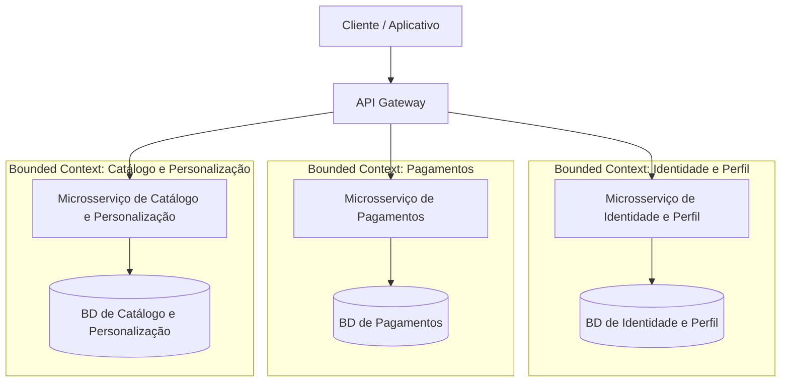

# Laboratório 01: Decomposição de Monolitos e Cloud-Native

**Disciplina:** Engenharia de Backend **Professor:** Ronaldo Amaral **Aluno:** Igor Almenara Carneiro **Matrícula:** 202311200124

> **Diretriz de Execução:** Este laboratório deve ser desenvolvido e submetido **individualmente**. Realize seus commits com as respostas diretamente neste arquivo no repositório da disciplina.

---

## Cenário Base: MonolitoShop

O e-commerce **MonolitoShop** roda em um único servidor e compartilha um banco de dados relacional gigante. Com a proximidade de picos de acesso, a equipe de engenharia identificou falhas graves de lentidão e travamentos. Você foi escalado para planejar a modernização arquitetural deste sistema legado.

### Parte 1: Bounded Contexts e Microsserviços (Eixo Y \- Decomposição)

Atualmente, a classe `Usuario` no código fonte do monolito possui 45 atributos, misturando dados de login, endereço de entrega, número do cartão de crédito e histórico de navegação no catálogo. O objetivo do Eixo Y é extrair fronteiras de negócio (*Bounded Contexts*) para projetar nossos futuros microsserviços.

**Tarefa 1.1 \- Mapeamento:** Separe o sistema em 3 Bounded Contexts principais (ex: Identidade, Pagamentos, Logística) que atuarão como microsserviços independentes. Distribua quais informações da classe "Usuário" legado devem pertencer a cada novo microsserviço.

> **Sua Resposta 1.1:**

> - **Microsserviço 1 (Identidade e perfil):** Microsserviço responsável pelo cadastro da conta, identificador de usuário, e-mail, credenciais de acesso (com senhas armazenadas como hashes) e catálogo de endereços de entrega cadastrados (cadastrados como dados do perfil). Quando um pedido é confirmado, o endereço selecionado pode ser registrado como uma cópia no pedido, evitando que alterações no cadastro modifiquem entregas anteriores.
> - **Microsserviço 2 (Pagamentos):** Microsserviço responsável pelos métodos de pagamento associados ao identificador do usuário, como tokens de cartões fornecidos por um processador de pagamentos, além dos dados necessários para autorizar e acompanhar transações. Observação: o número completo do cartão não deve ser mantido na classe 'usuário' ou armazenado sem os controles de segurança necessários. 
> - **Microsserviço 3 (Catálogo e Personalização):** Microsserviço responsável pelo histórico de navegação no catálogo, como produtos visualizados, buscas e interações, vinculados ao identificador do usuário. Os dados também podem servir para apoiar a personalização de recomendações e a experiência de compra.

Cada contexto é dono de seus dados e os outros serviços podem acessá-los por interfaces definidas, assim garantindo interoperabilidade entre os serviços, mas desacoplamento. Em uma eventual evolução, o processo de entrega pode ser separado em um contexto específico de logística.

**Tarefa 1.2 \- Diagrama de Arquitetura:** Crie um diagrama demonstrando a quebra do monolito nesses 3 novos microsserviços. O diagrama deve ilustrar as fronteiras dos contextos e seus respectivos bancos de dados isolados. (Utilize a sintaxe Mermaid diretamente neste Markdown ou insira o link de uma imagem gerada em ferramentas como draw.io/Lucidchart).

> **Exemplo de como estruturar seu diagrama Mermaid (Substitua pelos seus dados e expanda conforme necessário):**

> ```mermaid
> graph TD
>     Client[Cliente / App] --> API[API Gateway]
>     
>     API --> MS1[Microsserviço A]
>     API --> MS2[Microsserviço B]
>     API --> MS3[Microsserviço C]
> 
>     MS1 --> DB1[(Banco de Dados A)]
>     MS2 --> DB2[(Banco de Dados B)]
>     MS3 --> DB3[(Banco de Dados C)]
> ```

> **Sua Resposta 1.2 (Insira seu diagrama abaixo):**



O diagrama foi gerado com auxílio de IA. Ele é bem rudimentar e segue à risca a proposta de composição de microsserviços anterior, sem grandes alterações.

### Parte 2: O Cubo AKF e a Escalabilidade (Eixo X \- Clonagem)

Durante os testes de carga, o servidor web atingiu 100% de CPU. A equipe decidiu colocar um *Load Balancer* e subir 3 instâncias idênticas do servidor. No entanto, ao fazer isso, os clientes começaram a reclamar que os itens desapareciam misteriosamente do carrinho de compras a cada clique.

**Tarefa:** Explique por que os itens somem do carrinho ao clonar o servidor (estado) e qual é a solução Cloud-Native (Stateless) para resolver este problema.

> **Sua Resposta:** Quando o servidor é clonado, o balanceador de carga distribui as requisições entre instâncias diferentes. Se o carrinho é salvo na memória ou na sessão local de cada instância, uma requisição enviada ao servidor B não encontra o carrinho criado no servidor A. Portanto, parece que os itens desapareceram, mas ainda podem estar na memória da primeira instância. 

> A solução é tornar as instâncias da aplicação stateless -- ou seja, que processam requisições de forma independente. Dessa forma, elas não dependem de dados de sessões guardados na memória local para atender a próxima requisição. O carrinho pode ser armazenado em um repositório compartilhado, identificado por um ID de sessão ou de usuário. Daí, qualquer instância consulta e atualiza o mesmo carrinho.
> Quando for necessária persistência durável, pode-se recorrer a um banco de dados.

### Parte 3: Particionamento de Dados (Eixo Z)

O serviço de Pedidos foi extraído com sucesso do monolito, mas seu banco de dados começou a apresentar lentidão devido ao volume massivo de transações originadas de todo o Brasil.

**Tarefa:** Proponha uma estratégia de *Sharding* (particionamento) para o banco de dados de Pedidos. Qual seria a sua chave de partição (Shard Key) e por quê?

> **Sua Resposta:** Proponho implementar o sharding horizontal por hash do cliente_id -- poortanto, hash por cliente. Dessa forma, todos os pedidos associados a um único cliente ficam mantidos em um único BD, evitando a consulta em diferentes BDs durante a navegação.
> Os pedidos são distribuídos em diferentes partições, o roteador calcula a partição a partir do identificador do cliente e todos os pedidos são direcionados ao mesmo shard. Dessa forma, consultas mais frequentes como "listar pedidos do cliente" é mais rápida.
> Em contrapartida, relatórios que consultem pedidos de todos os clientes podem precisar acessar vários shards, e clientes com muitos pedidos podem gerar pontos de concentração. É preciso conferir em detalhe o padrão real das consultas de carga.